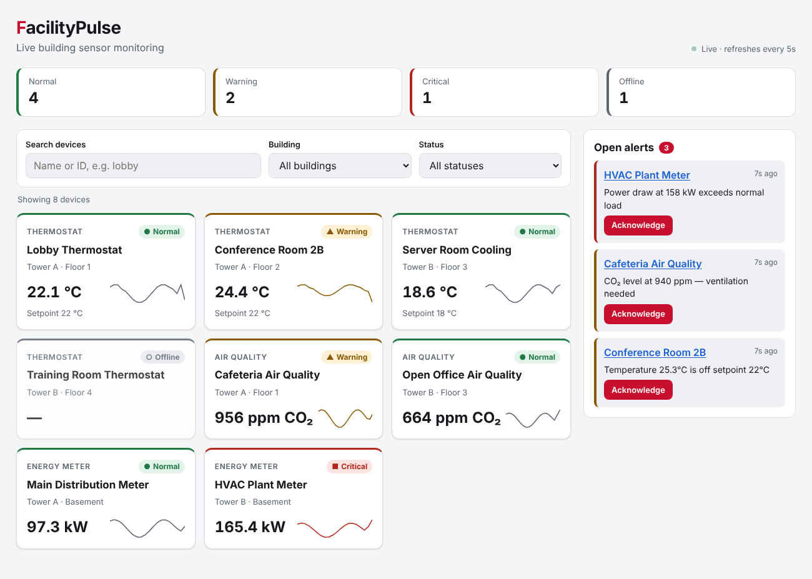

# FacilityPulse

A live monitoring dashboard for building sensors — thermostats, air-quality monitors and energy meters across multiple buildings. Facility managers can see every device's health at a glance, filter and search, drill into a device's trend, adjust thermostat setpoints, and acknowledge alerts.

**Stack:** React 18 · TypeScript · Vite · Node.js · Express · Vitest · React Testing Library · Supertest · GitHub Actions



---

## Features

- **Live data** — the API simulates sensor readings every 3 s; the UI polls every 5 s and shows a live/connection-lost indicator.
- **Status at a glance** — each device is classified as Normal / Warning / Critical / Offline using per-type thresholds, with a summary bar for the whole estate.
- **Filter & search** — by building, status and name/ID. Search is debounced so it doesn't fire a request on every keystroke.
- **Device detail panel** — current reading, 20-reading trend line (plain SVG, no chart library) and last-updated time.
- **Thermostat control** — change the target temperature with client-side validation that mirrors the server's rules; the server still validates everything.
- **Alerts** — raised automatically when a device gets worse; acknowledge them from the side panel.
- **Responsive** — works from 360 px phones to wide desktops; light and dark mode follow the OS setting.

## Accessibility

- Status is shown with **text and a shape**, never colour alone.
- Every card is a real `<button>`, so it's keyboard-focusable and works with Enter/Space.
- The detail panel is a labelled `role="dialog"`: focus moves into it on open, **Escape** closes it, and focus returns to the card that opened it.
- All form controls have `<label>`s; invalid input sets `aria-invalid` and links the error with `aria-describedby`.
- Loading, errors and save confirmations are announced through `aria-live` regions.
- Skip link, visible `:focus-visible` outlines, and `prefers-reduced-motion` support.

## Architecture

```
facilitypulse/
├── server/                 Express + TypeScript REST API
│   ├── src/types.ts        Shared domain types (Device, Alert)
│   ├── src/store.ts        In-memory data + sensor simulation + status rules
│   ├── src/app.ts          Routes, validation, error handling (no listen → testable)
│   ├── src/index.ts        Starts the server and the simulation timer
│   └── tests/api.test.ts   Supertest API tests
├── client/                 React + TypeScript UI (Vite)
│   ├── src/api/client.ts   Typed fetch wrapper with ApiError
│   ├── src/hooks/          usePolling (race-safe), useDebouncedValue
│   ├── src/components/     DeviceCard, DeviceDetail, FilterBar, AlertsPanel, …
│   └── src/test/           Component + integration tests
└── .github/workflows/ci.yml  Typecheck, test and build on every push/PR
```

**Design decisions worth knowing:**

- `createApp(store)` returns the Express app without calling `listen`, so tests run against it directly. The store takes an injectable random function, which makes the simulation deterministic in tests.
- `usePolling` tags each request with an ID and ignores responses that arrive after a newer request — prevents stale results flashing in when you change filters quickly.
- The detail panel reads its device from the live list (not a copy), so it keeps updating while open. It's keyed by device ID so its form resets cleanly when you switch devices.
- The API never leaks internal errors: unknown routes get a JSON 404, malformed JSON gets a 400, anything unexpected is logged and returned as a generic 500. CORS is restricted to the frontend origin and request bodies are capped at 10 kB.

## REST API

| Method | Endpoint | Description |
| --- | --- | --- |
| GET | `/api/health` | Health check |
| GET | `/api/buildings` | List of building names |
| GET | `/api/devices?building=&status=&q=` | Devices, optionally filtered (400 on unknown status) |
| GET | `/api/devices/:id` | One device (404 if missing) |
| PATCH | `/api/devices/:id/setpoint` | Body `{ "setpoint": 23.5 }` — thermostats only, 16–30 °C (400/404/409) |
| GET | `/api/alerts?open=true` | Alerts, newest first; `open=true` hides acknowledged ones |
| POST | `/api/alerts/:id/acknowledge` | Acknowledge an alert |

## Running it

Requires Node.js 20+.

```bash
npm install            # installs concurrently at the root
npm run install:all    # installs server and client dependencies
npm run dev            # API on :4000, UI on http://localhost:5173
```

Or run them separately: `cd server && npm run dev` and `cd client && npm run dev`.

## Testing

```bash
npm test               # runs both suites
npm run typecheck
```

- **API (15 tests):** filtering, validation for every bad-input case, 404/409 paths, malformed JSON, alert lifecycle, simulation history and status thresholds.
- **UI (21 tests):** components in isolation (keyboard use, focus management, validation, error states) plus integration tests that render the whole app against a mocked `fetch` backend.

CI runs typecheck → tests → build for both apps on every push and pull request.

## Possible next steps

- Swap polling for WebSockets/Server-Sent Events.
- Persist data in PostgreSQL and add authentication with role-based access (viewer vs operator).
- Add Playwright end-to-end tests and an axe accessibility check in CI.
- Deploy the UI to Vercel and the API to Azure App Service.
